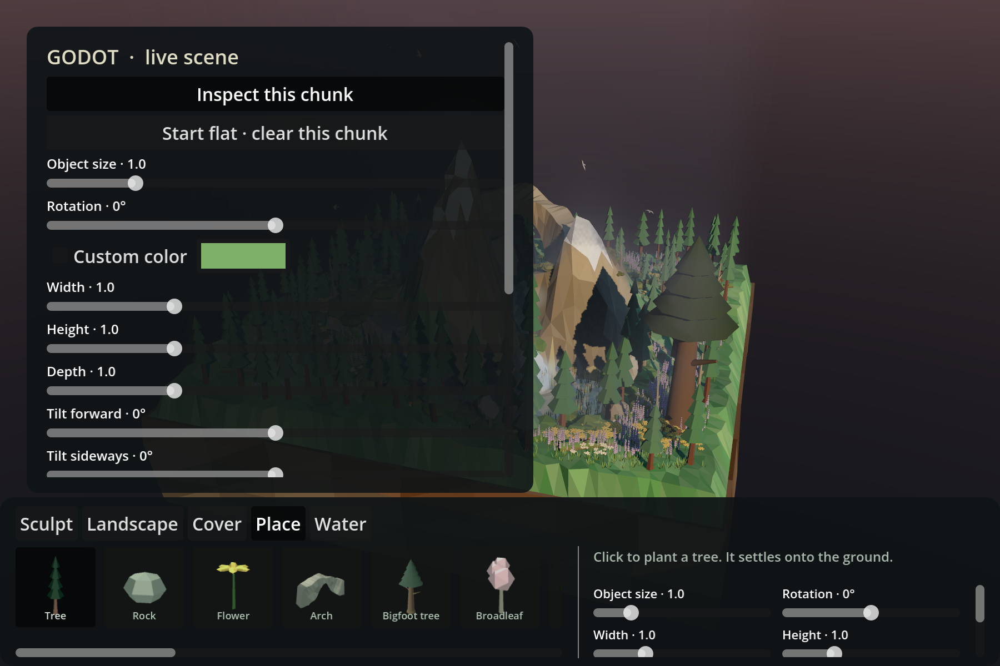
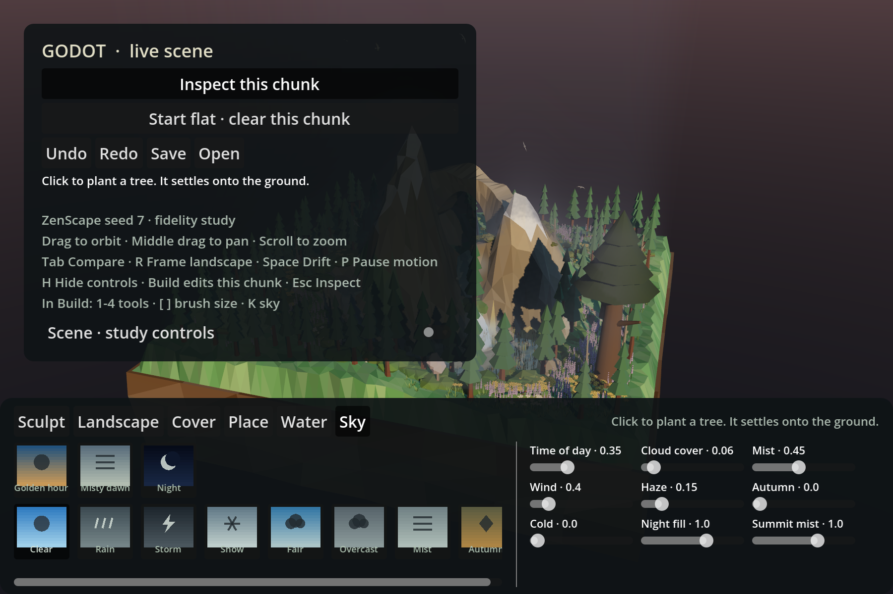

# ZenScape — Landscape Sandbox

A new Godot project exploring a cozy landscape sculpting toy. One continuous,
editable diorama: shape a place with a brush, then gradually bring it to life.

## ZenScape fidelity study

Double-click **`run-fidelity.command`** to explore a real ZenScape scene rendered
in Godot with Forward+. **Tab** compares it with the source screenshot; drag to
orbit, scroll to zoom, and **Esc** returns to sculpting. This study imports the
original terrain and 5,366 placed instances and adds native wind, bird, and water
motion. The imported scenery is not yet sculptable.

The motion pass preserves shallow-water depth, adds downstream stream highlights
and a deforming waterfall, and gives birds alternating flaps and glides. Use the
wind slider, **P** to pause motion, and middle-drag to pan. The quality selector
offers Beauty and Balanced post-processing. The scene renders at the display's
native resolution; see `docs/garden/VALIDATION.md` for the frame-time budget.

The environment controls now include wind direction and gusts (**G**), valley
fog, time of day and cycling (**N** advances the sun), aurora, rainbow, and
clear/rain/storm/snow transitions. Cloud cover and light-shaft controls now
share the source cloud field with terrain shadows and pooled fog. The **Cold**
slider freezes water over time; snow accumulates on exposed surfaces and warmth
thaws it. Rain wets ground and foliage, with rainbows emerging as clouds clear.
**Night fill** adjusts landscape readability after dark while preserving the
dark sky; set it to zero for deeper silhouettes.
**Summit mist** independently adjusts the mountain's cloud cap and downwind
spill; zero removes them while keeping valley fog.
**Hold rainbow** keeps one visible while sunlight permits it. See the
[winter comparison](docs/fidelity/winter-comparison.mp4) (winter left, warm right).
**Face rainbow** turns toward the arc and raises the view. Automatic rainbows
fade during snowfall and return in warm, humid clearing air.

Fireflies drift and blink above damp undergrowth on warm nights. Rain quiets
them and cold suppresses them. **Invite fireflies · even in daylight** brings
them out during daytime exploration; **P** freezes their motion and blinking.
Pond frogs breathe, hop into the water and paddle back to their banks, leaving
soft contact ripples. **F** startles them; cold, ice and an empty pond hide them.

Wind, rain and positional waterfall ambience follow weather, growth and freezing.
Their checkbox and volume slider are independent of thunder. **P** pauses all
audio along with scene motion.

**B** summons the original Bigfoot peek rig
in a terrain clearing; **T** triggers the original camera tremor. **P** freezes
these animations, including weather transitions and the encounter pose.

[Bigfoot motion check](docs/fidelity/bigfoot-motion.mp4): moving encounter on the
left, frozen control on the right. The imported rig is checked against 1,300
source joint transforms. See the [full parity checklist](docs/fidelity/PARITY.md)
for completed pieces and remaining systems.

[Six-second motion comparison](docs/fidelity/motion-comparison.mp4): updated Godot
on the left, previous Godot on the right. See [motion pass notes](docs/fidelity/MOTION.md)
for controls and the first motion pass; that video predates the environment work.

[Moving cloud comparison](docs/fidelity/cloud-comparison.mp4) · Godot left,
original Three.js right. The comparison still shows open lighting/fog differences.

[Comparison and remaining gaps](docs/fidelity/NOTES.md) ·
[Godot / Three.js video](docs/fidelity/comparison.mp4)

## Run

Open `project.godot` in **Godot 4.7.2** (standard edition; no .NET needed), then
press **F5** for the fidelity scene with Forward+ lighting and volumetric fog.
Open `scenes/sandbox.tscn` and press **F6** for the sculpting prototype, or use
**Esc** from the fidelity scene.

## Build your own garden

Double-click **`run-sandbox.command`**, open `scenes/sandbox.tscn` and press F6,
or press Esc from the fidelity scene. Existing terrain saves migrate automatically.
Use **Start flat** for bare earth; Undo restores the previous garden.

Build opens a **palette** across the bottom of the screen: category tabs
(Sculpt, Landscape, Cover, Place, Water, Sky) over one row of large tiles. Every
tree, rock, flower, arch and catalog piece shows a portrait of the object itself,
and every control for the tool in hand sits beside the row: its sliders, its
one-shot actions (Form ground foundation, Form mountain landscape, Fill
landscape streams / waterfall / flora, Cover chunk in grass, Remove Blades-tool
patches) and its colour - the Paint colour, or the Custom color box and picker
that tint a placement. Click a tile to pick the tool, or **drag a tile into the
world**: a translucent ghost follows the ground under the pointer, and releasing
plants the object with its drop reaction. Releasing away from the ground
cancels.

The **Sky** tab (or **K**) holds the weather instead of a tool, so the brush in
hand is untouched while you work on it: swatches for Golden hour, Misty dawn and
Night, one for every weather preset (Clear, Rain, Storm, Snow, Fair, Overcast,
Mist, Autumn), and sliders for time of day, cloud cover, mist, wind, haze,
autumn, cold, night fill and summit mist. They read the scene back as it drifts,
so the fidelity study's own weather controls and these never disagree. The side
panel keeps only what is not per-tool: the Build/Inspect toggle, Start flat,
Undo/Redo, Save/Open and the status line.





- Raise a hill, lower a hollow, smooth slopes, or flatten to the clicked height.
- **Meadow:** brush grass and wildflowers onto the earth; slower strokes add density.
- **Tree / Rock / Flower:** click to place individual objects. Set Object size before
  placing; zoom closely to position a single daisy. Objects follow sculpted ground.
  Each placement plays a short reaction sized to the object: living things sprout
  out of the ground, a stump or snag settles onto it with a wisp of dust, a log
  lands and rocks to rest, and stone falls, squashes and throws a puff. Only a
  fresh placement reacts — Redo and reopening a save restore objects silently.
- **Pond:** dig a closed hollow, set Water level (default −0.1), then click its bed.
  Water fills connected ground below that level. Levels that spill off the plot
  are refused. Raising the bed can shrink or remove the visible pond; Undo restores it.
- **Erase:** brush away meadow and objects.
- Choose **Clear, Mist, Rain, or Snow**. Rain darkens surfaces and snow coats ground
  and foliage, with falling precipitation and an icy pond appearance.
- **Undo / Redo** cover terrain, planting, ponds, weather, and starting flat.
- **Save** writes the whole garden and camera framing to `user://landscape.json`.
  Reopening restores them. Changes also save on focus loss or normal close.

| Control | Action |
| --- | --- |
| Left drag | Sculpt / paint / erase |
| Left click | Place selected object / fill pond |
| Drag from a palette tile | Carry the object into the world and drop it |
| 1 / 2 / 3 / 4 | Raise / lower / smooth / flatten |
| K | Open the Sky tab, or fold it away |
| Right drag | Orbit |
| Middle drag | Pan |
| Scroll | Zoom, including close flower placement |
| [ / ] | Brush size |
| ⌘Z / Ctrl+Z | Undo |
| ⌘⇧Z / Ctrl+Shift+Z | Redo |
| ⌘S / Ctrl+S | Save |

The editable plot is currently 24 × 24 units with a 0.5-unit terrain grid.
It supports hills and hollows; caves and overhangs are outside this heightfield
model. Garden surfaces, water, lighting and atmospheric compositing now reuse the port;
precipitation remains a compact implementation. The next integration target is
Build mode directly inside the fidelity scene, with its original chunk and camera.

## Structure

- `scripts/garden_data.gd`: meadow, object identities, ponds, weather, full-world history, and versioned saves.
- `scripts/garden_view.gd`: original foliage meshes rendered from stable garden records.
- `scripts/garden_water.gd`: connected basin filling and clipped shorelines.
- `scripts/garden_weather.gd`: terrain-aware precipitation.
- `scripts/landscape_data.gd`: editable heights, brush operations, history, and
  validated serialization. Independent of scene nodes and rendering.
- `scripts/terrain_view.gd`: terrain mesh, earth sides, brush preview, ray picking.
- `scripts/orbit_camera.gd`: camera navigation.
- `scripts/sandbox.gd`: input, brush interface, save lifecycle.
- `scenes/sandbox.tscn`: scene composition, lighting, backdrop, and camera.
- `shaders/reference_surface.gdshader`: shared source surface shading and optional brush footprint.
- `scripts/landscape_lighting.gd`: the lighting/sky setup shared with the fidelity scene.
- `scripts/garden_look.gd`: current garden adapter for source lighting and atmosphere.
- `scripts/garden_surface_map.gd`: live ground/water fields for atmospheric occlusion.

There is one terrain mesh for now. Introduce internal tiles when measurements
justify local mesh rebuilds; tiles should remain invisible to the player.

## Checks

```sh
godot --headless --editor --path . --import
godot --headless --path . --script tests/test_landscape.gd
godot --headless --path . --script tests/test_garden.gd
godot --path . --script tests/test_scene.gd
godot --path . --script tests/test_garden_scene.gd
```

## Direction

Future slices: selecting and moving existing objects; assisted river drawing with
connected water; wildlife placement and gentle behavior; custom asset import.
See [garden checks and scope](docs/garden/VALIDATION.md) for the current loop.

An entire mountain that can be picked up would need an editable feature layer
above the sampled heights. Establish that interaction before adding such a layer.

The original Three.js ZenScape project remains a separate reference for landscape
recipes, atmosphere, water, and wildlife. This project has no runtime dependency
on it, and does not include its journal or writing-driven world structure.

Press **Y** to replay landscape formation, or use the terrain and foliage sliders.
**P** freezes the replay along with the other motion. Terrain, plants and water use
source growth data. **Refill water** replays the falls, stream and lake alone;
the water slider scrubs their fill. Wildlife arrival remains pending.

[Wind response comparison](docs/fidelity/wind-response-comparison.mp4): new native
wind on the left, previous native wind on the right, at strength 2. Source lean,
flutter, shiver and bending now use the captured foliage tuning.

Press **L** or **Lightning** for a strike; Storm also schedules strikes. Bolts
light the clouds and ground, followed by a spreading gust. **P** freezes the
sequence, including delayed thunder audio. Toggle **Thunder sound** to mute it. [Lightning comparison](docs/fidelity/lightning-comparison.mp4)
shows a strike on the left and a control on the right.

Around sunrise and sunset, a climbing shadow leaves the mountain peaks in
gold and rose afterglow. [Sunset comparison](docs/fidelity/alpenglow-comparison.png)
shows native Godot on the left and the original on the right.

A calm, clear dawn now pools mist below the peaks, then breaks it into patches
as the sun rises. Strong wind and overcast suppress the inversion.
[Dawn comparison](docs/fidelity/inversion-comparison.png): Godot left, original right.

**G** now sends traveling gusts through the shared air field. Nearby presses
strengthen the latest gust; older gusts continue across the landscape.
[Left-bank gust comparison](docs/fidelity/gust-comparison.mp4): gust left, control right.

Weather presets now control wind, mist and haze together with precipitation.
Fair, Overcast and Mist are available alongside Clear, Rain, Storm and Snow.
Use **Haze** for atmospheric depth; the wind slider reaches full storm strength.

Autumn is available in the weather selector, with a separate Autumn slider.
The turn preserves warm/cool green differences and warms the lighting; Snow
retains turned foliage under its snowpack. Canopy-bound falling leaves now share the seasonal and wind state.

The fidelity scene now blends fog after tone mapping, matching the source
compositing order. Use `--native-fog` to compare the previous volume renderer.
See docs/fidelity/DISPLAY-FOG.md for validation and remaining gaps.
