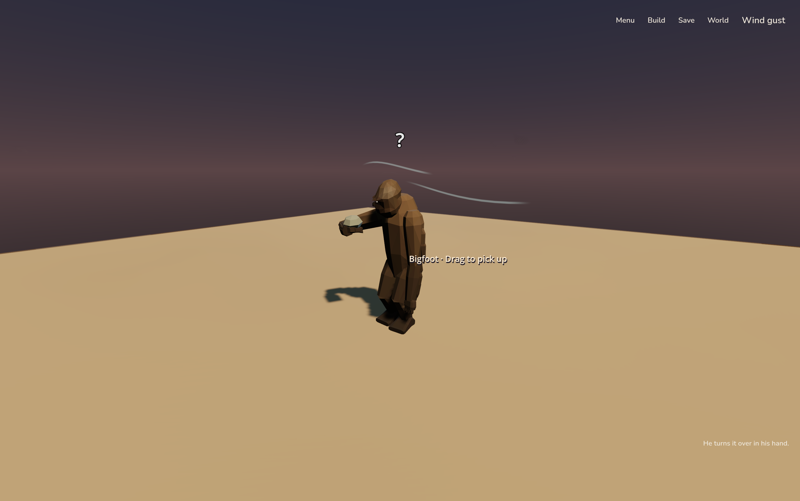

# Offering Bigfoot a rock

In Enjoy mode, drag a small rock near Bigfoot and hold it still in front of him.
Scroll while holding to raise or lower it. He follows it with his gaze, turns,
and reaches. Keep it within reach for about a second and his palm takes the same
physical rock from the cursor. Moving it away breaks the attempt; repeated
withdrawals make him more inclined to throw it away.

He turns the rock over, then chooses to set it beside him, test its heft and
roll it away, or wind up and throw it. A rock he keeps remains a favorite while
that physical instance is present. This first slice uses existing small rocks
(radius at most 0.36 world units); it does not introduce a pocket inventory,
new pinecone art, persistent relationship memory, or navigation to cliff edges.
A throw near an edge follows ordinary world physics.

Click the rock in his hand to take it back. Pause preserves an acquired grip.
Picking up Bigfoot, switching tools, changing the world, saving, or losing focus
ends the exchange and releases its ownership. An offer remains the player's
object until actual palm contact; fast motion or unreachable height cannot
cause a remote handoff. Existing activities finish before he considers an offer.

## Implementation and acceptance

`bigfoot_object_exchange.gd` owns watch/reach/inspect/resolve and actor ownership.
`world_loose_props.gd` transfers the existing held body atomically and clears
cursor throw samples, supplies height adjustment, and picks held props despite
their disabled physical collision. The product world arbitrates the exchange
against ordinary routines, environmental actions and autonomous mischief.

The integration test runs the real Diorama scene, authored rock promotion,
actor animation and frame loop. It covers unreachable offers, actual palm
contact, single ownership, stale throw-sample removal, pause/resume, player
click takeover, every outcome, return to ordinary life and Build cleanup.

Run `tests/test_bigfoot_object_exchange.gd` with Godot's `--script` option.
Add `-- --capture-exchange` with rendering enabled to save an inspection frame
to `/private/tmp/bigfoot-exchange-inspect.png`.

Rendered validation uses the same scene and hand solver on Metal / Forward+.
Inspection, lowering and throwing were visually checked. Maximum measured
palm error through lowering was about 0.10 world units; the throw stayed in
palm contact. The final rendered integration run reports zero failures,
including focus-loss cleanup. Godot still emits renderer cleanup diagnostics
when the test exits.

The code review found one transfer edge case (stale steadiness after a fast
withdrawal), which was fixed and regression-tested. Standards review found no
blocking issues; availability checks still follow the surrounding controllers'
existing direct access to world/routine state.

The same integration sequence also passes through the current Cozy Worlds
entry point (`-- --cozy-exchange`), including its earlier regrowth input handler.
Standalone loose-prop cursor regression checks also pass.

Full headless sweep: **154/234 pass**, with 63 failures, 2 script-error exits,
and 15 timeouts. Fatal script-error runs were ended early once already failed.
This is not a clean full-suite claim: failures include unavailable headless
images, old scene fixtures, and the export check expecting the previous entry
scene. The related Diorama flow/environment/world-play, resident interaction,
carry, gust, loose-prop cursor, and autonomous mischief checks pass.
[Detailed validation results](validation.json) record the full sweep.
